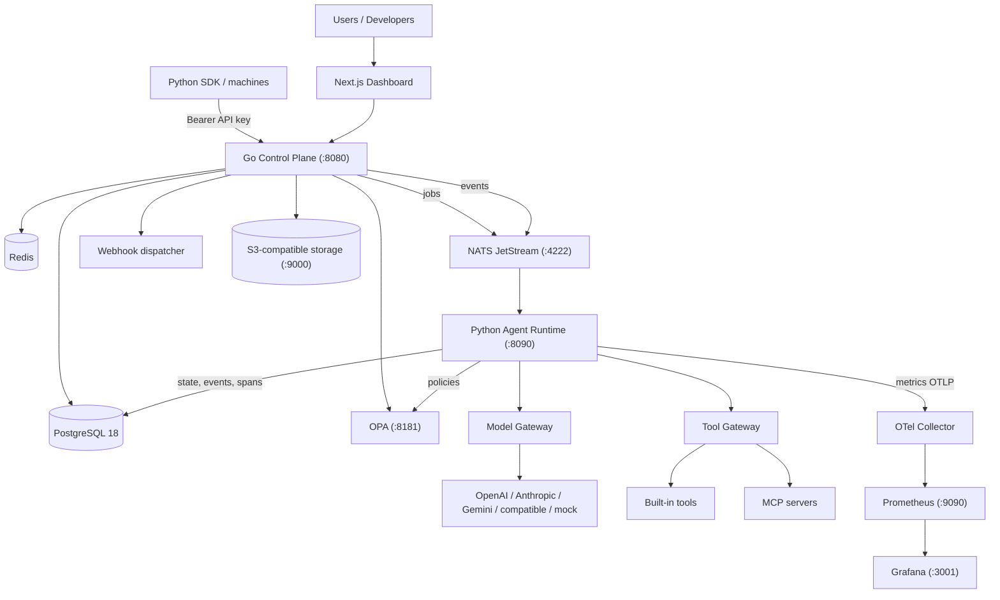
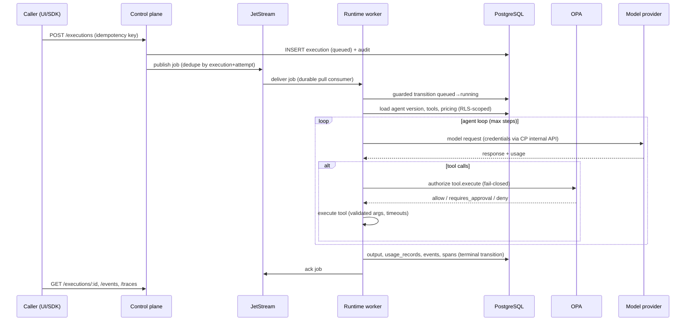

# System Overview

AgentOS is an enterprise control plane for AI agents: a platform to register, version, deploy, execute, observe, evaluate and govern agents the way enterprises treat other production workloads.

## The problem

Organizations deploying AI agents across teams face fragmented management, inconsistent access control, uncontrolled model spend, limited observability, credential sprawl and no accountability. AgentOS provides a unified operating layer with:

- **Tenant isolation** — organization-scoped data enforced at the application layer *and* by PostgreSQL row-level security.
- **Identity** — every agent can carry its own credential with an independent lifecycle.
- **Immutable versions** — a published agent version can never change; executions reference the exact version used.
- **Governance** — OPA-evaluated authorization with fail-closed semantics, human approvals for sensitive operations, and a complete audit trail.
- **Cost control** — versioned pricing, token metering, budget enforcement executed on the backend.
- **Observability** — structured execution events, OpenTelemetry spans, Prometheus metrics.

## High-level architecture

## The two planes

| | Control plane (Go) | Execution plane (Python) |
| --- | --- | --- |
| Responsibility | Registry, auth, governance, budgets, API | Job consumption, agent loop, tools, metering |
| Database role | `agentos_api` (full app surface) | `agentos_worker` (narrow, execution-focused) |
| Talks to | PostgreSQL, NATS, OPA, Redis | PostgreSQL, NATS, OPA, providers |
| Never does | Runs agent workloads in request handlers | Owns registry truth |

The control plane submits jobs and manages lifecycle; dedicated runtime
workers consume execution jobs from JetStream and execute them
independently. This separation keeps HTTP handlers free of arbitrary
agent workloads.

## Data flow of one execution

## Technology stack

| Layer | Technology |
| --- | --- |
| Dashboard | Next.js (App Router), React 19, TypeScript strict, Tailwind v4, TanStack Query |
| Control plane | Go 1.27, chi, pgx v5, NATS JetStream, slog |
| Runtime | Python 3.13, FastAPI, asyncpg, httpx, official MCP SDK |
| SDK | Python (httpx), typed errors |
| Datastore | PostgreSQL 18 (RLS), Redis, S3-compatible object storage |
| Governance | Open Policy Agent 1.x |
| Observability | OpenTelemetry → Prometheus → Grafana |
| Local infra | Docker Compose (8 services) |
| Quality | go test -race, pytest, vitest, ruff, mypy, eslint, gitleaks, trivy, govulncheck, k6 |

## Milestone map

The build order followed the master directive: foundation → infrastructure → database → auth → agents → models → runtime → tools/MCP → governance → deployments → observability → costs → evaluations → frontend → SDK/webhooks → security → documentation → demo → release.
