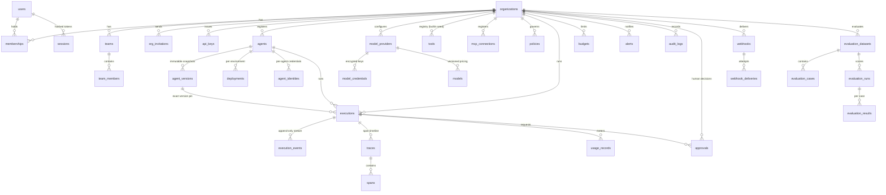

# Database Architecture

PostgreSQL 18 with 14 versioned migrations (`services/control-plane/migrations/`)
defining 30 tables. Apply with `make migrate`.

## Entity relationship overview



## Conventions

- **UUID primary keys** (`gen_random_uuid()`), `timestamptz` UTC timestamps,
  `created_at`/`updated_at` with trigger maintenance.
- **Enums as text + CHECK** constraints (status machines validated in the
  database as well as the services).
- **Money as BIGINT minor units** — never floats. Pricing is per-1M-token,
  versioned (`pricing_version`); usage rows distinguish provider-reported
  vs estimated cost.
- **Soft deletion** for organizations, users, agents (partial unique
  indexes respect `deleted_at IS NULL`).
- **Immutability**: published agent versions are guarded by a trigger;
  execution events, usage records, policy decisions and audit logs are
  append-only *by grant* (app roles receive no UPDATE/DELETE).
- **Idempotency**: partial unique index on
  `(organization_id, idempotency_key)` for executions.

## Row-level security

Every organization-scoped table carries:

```sql
CREATE POLICY tenant_isolation ON <table>
  USING (organization_id = agentos_current_org())
  WITH CHECK (organization_id = agentos_current_org());
```

`agentos_current_org()` reads `agentos.org_id` from the transaction
(`NULLIF(current_setting(...), '')` — session placeholders normalize to
NULL, see migration 000010). Unset context yields no rows and rejects
writes: default deny.

`organizations` itself has tailored policies (members read their orgs via
a SECURITY DEFINER membership check; inserts are authenticated and
application-controlled).

## Roles

| Role | Purpose | Notable grants |
| --- | --- | --- |
| `agentos` (owner) | migrations, DDL | everything |
| `agentos_api` | control plane | full DML on operational tables; INSERT/SELECT on append-only |
| `agentos_worker` | execution plane | SELECT on registry/telemetry inputs; UPDATE executions; INSERT events/spans/usage/decisions/alerts/approvals; **no** users/sessions/api_keys/credentials/audit |

## Migrations

```bash
make migrate   # applies pending migrations as the owner role
```

Applied migrations are immutable; the runner detects renamed or edited
history and refuses to continue.
